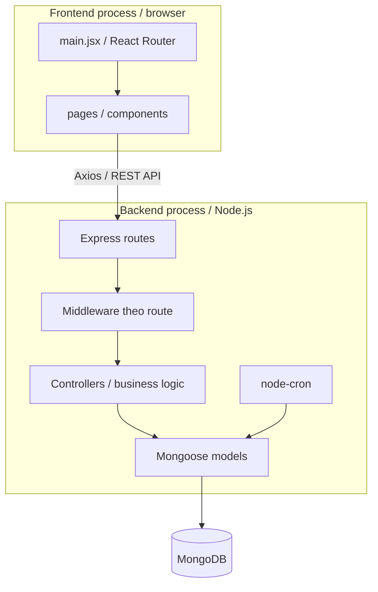
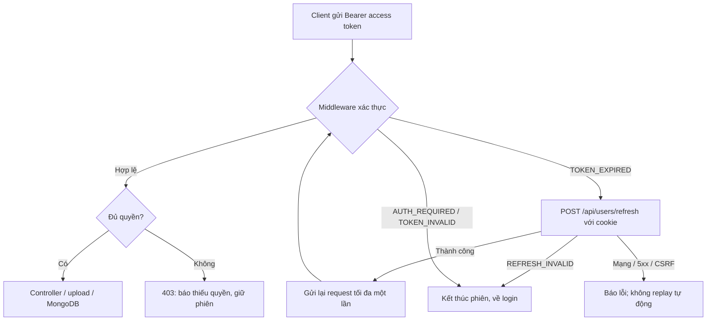
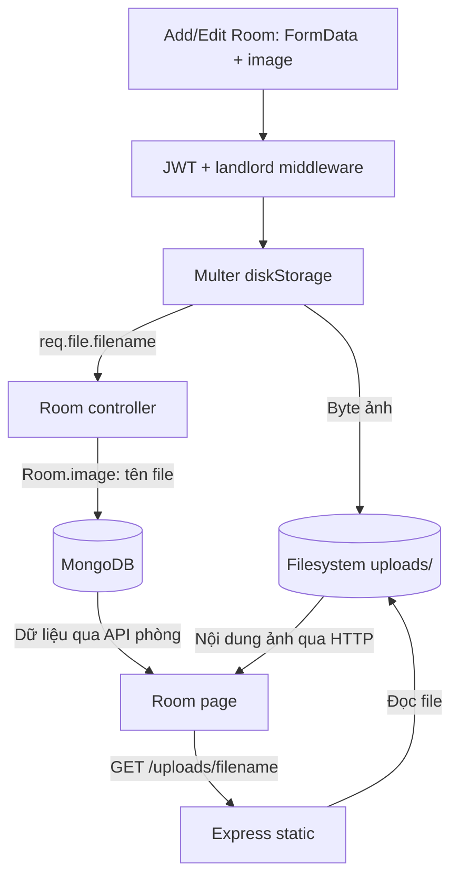

# DOMIS — Source Architecture

Tài liệu mô tả kiến trúc hiện tại của DOMIS: cách tổ chức source, đường đi của request, quan hệ dữ liệu và nơi lưu ảnh. Các liên kết trong từng phần trỏ tới mã triển khai tương ứng.

Để cài đặt và chạy ứng dụng, xem [hướng dẫn trong README](README.md#cài-đặt-và-chạy-cục-bộ).

## Mục lục

- [Tổng quan thành phần](#tổng-quan-thành-phần)
- [Frontend](#frontend)
- [Backend](#backend)
- [Xác thực và request nghiệp vụ](#xác-thực-và-request-nghiệp-vụ)
- [Upload và phục vụ ảnh](#upload-và-phục-vụ-ảnh)
- [Mô hình dữ liệu](#mô-hình-dữ-liệu)
- [Tác vụ hợp đồng hết hạn](#tác-vụ-hợp-đồng-hết-hạn)
- [Môi trường và cấu hình](#môi-trường-và-cấu-hình)
- [Ranh giới vận hành](#ranh-giới-vận-hành)

## Tổng quan thành phần

Source gồm hai ứng dụng độc lập: frontend React/Vite và backend Node.js/Express. Frontend gọi REST API; controllers xử lý nghiệp vụ và truy cập MongoDB qua Mongoose. Không có tầng service/repository riêng giữa controller và model.

Đây là sơ đồ thành phần tổng quan. Middleware được cấu hình theo từng route, không phải mọi request đều đi qua cùng một chuỗi xác thực; static ảnh có luồng riêng ở phần upload.

| Khu vực source | Trách nhiệm |
| --- | --- |
| [frontend/src/main.jsx](frontend/src/main.jsx) | Khởi tạo React, khai báo route và gắn `RouterProvider`. |
| [frontend/src/pages/](frontend/src/pages/) | Các màn hình phòng, khách thuê, dashboard, dịch vụ, điện nước, hóa đơn và Booking Planner. |
| [frontend/src/components/](frontend/src/components/) | Biểu mẫu, bảng, biểu đồ, bố cục và thao tác đăng nhập/đăng ký. |
| [frontend/validations/](frontend/validations/) | Schema kiểm tra dữ liệu biểu mẫu. |
| [backend/index.js](backend/index.js) | Lắp ghép Express, CORS, API routes, static files và lịch cron. |
| [backend/routes/](backend/routes/) | Ánh xạ HTTP method/path tới middleware và controller. |
| [backend/middleware/](backend/middleware/) | Xác thực JWT, kiểm tra vai trò và xử lý tệp tải lên. |
| [backend/controllers/](backend/controllers/) | Validation và logic nghiệp vụ, truy vấn model, trả HTTP response. |
| [backend/models/](backend/models/) | Schema, tham chiếu, index và hook Mongoose. |
| [backend/db/db.js](backend/db/db.js) | Kết nối database từ biến môi trường. |
| [backend/cronJobs/](backend/cronJobs/) | Tác vụ định kỳ chạy cùng backend process. |

## Frontend

[main.jsx](frontend/src/main.jsx) dùng `createBrowserRouter` để ánh xạ URL sang page/component, rồi render `RouterProvider` trong `StrictMode`. Các route chính gồm `/login`, `/register`, `/dashboard`, `/rooms`, `/service`, `/electric`, `/water`, `/customer`, `/payment` và `/booking-planner`.

Pages/components nghiệp vụ dùng [apiClient.js](frontend/src/utils/apiClient.js), base `/api`, tự gắn access token hiện tại. Chỉ `401 TOKEN_EXPIRED` được refresh và replay một lần; FormData giữ boundary của browser. Request lỗi không thể xác định kết quả không được tự gửi lại.

[authSession.js](frontend/src/utils/authSession.js) quản lý access token/user và epoch/version trong localStorage, single-flight, Web Locks và thông báo storage/BroadcastChannel giữa các tab. Signin/refresh/logout serialize cùng một lock để response cũ không thay cookie hoặc khôi phục phiên đã logout. Refresh token chỉ ở cookie HttpOnly.

[RequireAuth.jsx](frontend/src/components/RequireAuth.jsx) chặn route nghiệp vụ trước mount khi không có phiên cục bộ; backend vẫn là nguồn xác thực/phân quyền. [SessionNotice.jsx](frontend/src/components/SessionNotice.jsx) giữ form khi refresh lỗi tạm thời và cho Thử lại có chủ đích; thao tác đó chỉ phục hồi phiên, không gửi lại thao tác ghi chưa rõ kết quả. Logout chưa xác nhận server hoặc bị ngắt khi reload/đóng tab có nút thử lại thu hồi phiên.

Style được tổ chức trong [src/styling/](frontend/src/styling/). Validation có cả schema trong `validations/` và kiểm tra tại component; không mặc định mọi form đều dùng cùng một cơ chế.

## Backend

[backend/index.js](backend/index.js) tải biến môi trường, gọi kết nối database, tạo Express app, cấu hình CORS và JSON body, đăng ký routes/static, sau đó mở cổng HTTP và khởi động cron trong callback `listen`.

Startup đợi kết nối MongoDB và khởi tạo index của refresh session trước khi mở cổng HTTP. [db.js](backend/db/db.js) dùng `MONGO_URL` và kết thúc process nếu kết nối thất bại; lỗi cấu hình `APP_ORIGIN` hoặc index cũng ngăn startup hoàn tất.

### Các module API

| Tiền tố | Router | Nghiệp vụ chính |
| --- | --- | --- |
| `/api/users` | [userRoutes.js](backend/routes/userRoutes.js) | Đăng ký, đăng nhập, refresh và logout phiên. |
| `/api/rooms` | [roomRoutes.js](backend/routes/roomRoutes.js) | Quản lý phòng, trạng thái, thống kê và tra cứu khả dụng. |
| `/api/tenant` | [tenantRoutes.js](backend/routes/tenantRoutes.js) | Hồ sơ khách thuê. |
| `/api/contracts` | [contractRoutes.js](backend/routes/contractRoutes.js) | Hợp đồng, khách thuê theo hợp đồng, danh sách sắp hết hạn. |
| `/api/services` | [serviceRoutes.js](backend/routes/serviceRoutes.js) | Dịch vụ và đơn giá. |
| `/api/electric-meters` | [electricMeterRoutes.js](backend/routes/electricMeterRoutes.js) | Chỉ số điện và lịch sử. |
| `/api/water-meters` | [waterMeterRoutes.js](backend/routes/waterMeterRoutes.js) | Chỉ số nước và lịch sử. |
| `/api/payments` | [paymentRoutes.js](backend/routes/paymentRoutes.js) | Tính hóa đơn, danh sách, chi tiết và ghi nhận khoản thu. |

Controllers truy cập model trực tiếp. Ví dụ [paymentController.js](backend/controllers/paymentController.js) kết hợp phòng, hợp đồng, dịch vụ và bản ghi đồng hồ để tạo hóa đơn; ghi nhận khoản thu là cập nhật dữ liệu nội bộ, không phải tích hợp cổng thanh toán.

## Xác thực và request nghiệp vụ

[userController.js](backend/controllers/userController.js) đăng ký tài khoản `landlord` với mật khẩu hash bằng `bcryptjs`. Đăng nhập giữ JSON `accessToken`/`user` và đặt cookie refresh; token refresh không nằm trong JSON hoặc localStorage.

- Access JWT ký bằng `SECRET_KEY`, chứa `id`/`role`, có hạn **300 giây**. Access token cấp sát cuối phiên không vượt hạn tuyệt đối của phiên.
- [RefreshSession.model.js](backend/models/RefreshSession.model.js) lưu user, hash token hiện tại/lịch sử, thời điểm tạo/hết hạn và revocation. Phiên hết hạn sau **24 giờ từ đăng nhập**, không sliding; MongoDB TTL chỉ dọn dữ liệu, không thay kiểm tra hết hạn trong request.
- Refresh token opaque ngẫu nhiên 256 bit được rotation atomic sau mỗi refresh. Dùng lại token đã rotation thu hồi đúng phiên liên quan; refresh đọc lại user/role hiện tại. Logout thu hồi phiên refresh, không thu hồi ngay JWT stateless đã cấp.

[authMiddleware.js](backend/middleware/authMiddleware.js) trả `401` với `AUTH_REQUIRED`, `TOKEN_INVALID` hoặc `TOKEN_EXPIRED`; thiếu quyền vai trò/ownership vẫn `403`. Auth đứng trước controller và Multer, nên request bị từ chối do hết hạn chưa thu tiền, tạo hợp đồng hoặc ghi tệp. Không replay khi timeout/mất mạng/`5xx`, vì chưa biết thao tác đã thực hiện hay chưa.

Các endpoint điều khiển phiên không cần access token còn hạn nhưng được bảo vệ bởi [sessionSecurity.js](backend/middleware/sessionSecurity.js):

| Endpoint | Kết quả |
| --- | --- |
| `POST /api/users/signin` | `200` với accessToken/user và cookie refresh |
| `POST /api/users/refresh` | `200` và rotation cookie; `401 REFRESH_INVALID` nếu phiên không dùng được |
| `POST /api/users/logout` | Thu hồi phiên, xóa cookie, `204` idempotent |

Signin/refresh/logout yêu cầu `Origin` khớp chính xác `APP_ORIGIN` và `X-CSRF-Protection: 1`; sai/thiếu trả `403` trước khi thay đổi phiên. Response credentials có `Cache-Control: no-store`. Cookie `refreshToken` có `HttpOnly`, `SameSite=Strict`, `Path=/api/users`, không Domain; production thêm `Secure`, HTTPS và frontend/API cùng site. Chi tiết tạo token/cookie ở [sessionTokens.js](backend/utils/sessionTokens.js).

Access token vẫn có thể dùng đến `exp` sau logout, tối đa 5 phút với token mới. JWT legacy đã được ký hạn 1 ngày giữ `exp` cũ; không tự có refresh session và phải signin khi hết hạn. Static `/uploads` vẫn public; middleware role không thay kiểm tra ownership trong từng controller.

## Upload và phục vụ ảnh

[roomRoutes.js](backend/routes/roomRoutes.js) gắn `authenticateToken`, `authorizeLandlord`, rồi `upload.single("image")` trước controller tạo/cập nhật phòng. [upload.js](backend/middleware/upload.js) dùng `multer.diskStorage`, tạo tên file và ghi nội dung vào thư mục `uploads/` tương đối với thư mục làm việc của backend.

Trong [roomController.js](backend/controllers/roomController.js), trường `image` nhận `req.file.filename`. [Room.model.js](backend/models/Room.model.js) khai báo trường này là `String`: **MongoDB lưu tên file, không lưu byte ảnh**.

[Room.jsx](frontend/src/pages/Room.jsx) dựng URL ảnh từ tên file, còn `express.static("uploads")` trong [index.js](backend/index.js) phục vụ nội dung file. Đọc dữ liệu phòng và đọc file ảnh là hai request riêng; mũi tên từ MongoDB tới page trong sơ đồ là dữ liệu được backend trả qua API, không phải kết nối trực tiếp từ browser tới database.

Filesystem và MongoDB là hai nơi lưu trữ độc lập, không có transaction chung trong luồng này. File đã được Multer ghi trước khi controller lưu dữ liệu phòng; lưu database thất bại không đồng nghĩa file tự được hoàn tác. Middleware upload hiện cấu hình storage, chưa có `fileFilter` hoặc `limits`.

Ảnh của người dùng online được ghi trên host chạy backend, không tự ghi vào máy phát triển và không tự được commit/push lên GitHub.

## Mô hình dữ liệu

Dữ liệu nghiệp vụ được mô tả bằng schema Mongoose với tham chiếu `ObjectId` và object/array nhúng.

| Model | Quan hệ và dữ liệu chính | Source |
| --- | --- | --- |
| `User` | Tài khoản, mật khẩu đã hash và vai trò. | [User.model.js](backend/models/User.model.js) |
| `Room` | `landlordID` tham chiếu `User`; thông tin phòng, tên file ảnh; trạng thái `available`, `rented`, `disabled`. | [Room.model.js](backend/models/Room.model.js) |
| `Service` | `landlordID` tham chiếu `User`; loại `ELECTRIC`, `WATER`, `OTHER`, đơn giá và trạng thái dịch vụ. | [Service.model.js](backend/models/Service.model.js) |
| `Tenant` | Hồ sơ cá nhân và liên hệ của người thuê; được hợp đồng tham chiếu qua `tenantId`. | [Tenant.model.js](backend/models/Tenant.model.js) |
| `Contract` | `roomId` → `Room`, `tenantId` → `Tenant`, `serviceIds` → danh sách `Service`; thời hạn, tiền thuê, tiền cọc; trạng thái `active`, `terminated`, `expired`. | [Contract.model.js](backend/models/Contract.model.js) |
| `ElectricMeter` / `WaterMeter` | `contract_id` → `Contract`; chỉ số trước/hiện tại, ngày ghi và lượng tiêu thụ. | [ElectricMeter.model.js](backend/models/ElectricMeter.model.js), [WaterMeter.model.js](backend/models/WaterMeter.model.js) |
| `Payment` | `contract_id` → `Contract`, `room_id` → `Room`; chi tiết phí, số đã thu, dư nợ; trạng thái `unpaid`, `partial`, `paid`. | [Payment.model.js](backend/models/Payment.model.js) |

Các hook lưu đồng hồ kiểm tra chỉ số mới không nhỏ hơn chỉ số trước và tính `consumed = currentIndex - previousIndex`. Contract lưu tham chiếu dịch vụ; khi lập hóa đơn, controller lấy dịch vụ đang hoạt động và đơn giá hiện tại để ghi chi tiết vào Payment.

[createPayment](backend/controllers/paymentController.js) cộng tiền thuê trong hợp đồng, điện/nước theo tiêu thụ và đơn giá, cùng phí dịch vụ loại `OTHER`. Thiếu bản ghi đồng hồ hoặc đơn giá điện/nước có thể cho kết quả tương ứng bằng `0`; không có bước tự lấy số liệu từ thiết bị đồng hồ.

## Tác vụ hợp đồng hết hạn

[startContractExpirationJob](backend/cronJobs/contractExpirationJob.js) dùng `node-cron` và được gọi trong callback `app.listen`. Tác vụ chạy trong **cùng backend process**, không phải worker hay dịch vụ scheduler riêng.

Lịch `5 0 * * *` tương ứng **00:05 mỗi ngày**, theo múi giờ tiến trình Node.js vì không truyền tùy chọn timezone. Mỗi lượt:

1. Tìm hợp đồng `active` có `endDate` nhỏ hơn thời điểm hiện tại.
2. Đổi hợp đồng thành `expired` và lưu.
3. Đặt phòng liên quan thành `available`.

Không có lượt quét ngay lúc khởi động hoặc cơ chế chạy bù được cấu hình trong job này. Backend phải hoạt động khi đến lịch. Job cũng không kiểm tra phòng còn hợp đồng active khác trước khi chuyển trạng thái; không nên xem tác vụ này là bảo đảm chống trùng lịch thuê.

## Môi trường và cấu hình

| Thành phần | Chạy cục bộ | Bản online |
| --- | --- | --- |
| Frontend | Vite tại `http://localhost:3000` | Firebase Hosting |
| Backend | Express tại `http://localhost:5000` mặc định | Render Web Service |
| Database | MongoDB local hoặc cluster Atlas do người chạy tự cấu hình | MongoDB Atlas |
| Ảnh tải lên | Filesystem của máy chạy backend | Filesystem của backend host; cấu hình persistent disk chưa được xác minh |

Topology online trên được chủ dự án xác nhận. Tài liệu không khẳng định commit đang deploy giống checkout hiện tại hoặc mọi cấu hình cloud đã được kiểm tra.

### Các biến môi trường backend

| Biến | Vai trò | Điểm sử dụng |
| --- | --- | --- |
| `MONGO_URL` | Chọn server/cluster và database mà backend kết nối. | [db.js](backend/db/db.js) |
| `SECRET_KEY` | Ký và xác minh JWT. | [userController.js](backend/controllers/userController.js), [authMiddleware.js](backend/middleware/authMiddleware.js) |
| `PORT` | Cổng HTTP, mặc định `5000`. | [index.js](backend/index.js) |
| `APP_ORIGIN` | Origin frontend được phép, dev mặc định `http://localhost:3000`; production bắt buộc giá trị HTTPS chính xác, không có dấu `/` cuối. | [sessionSecurity.js](backend/middleware/sessionSecurity.js), [index.js](backend/index.js) |
| `NODE_ENV` | `production` bật cookie Secure và yêu cầu APP_ORIGIN HTTPS. | [sessionTokens.js](backend/utils/sessionTokens.js) |

Frontend dùng `/api` và `/uploads` cùng origin. [vite.config.js](frontend/vite.config.js) proxy dev tới `http://127.0.0.1:5000` hoặc `API_PROXY_TARGET`; cổng dev mặc định `3000`. Production dùng gateway HTTPS cùng origin theo [deploy/nginx.conf.template](deploy/nginx.conf.template); giữ Origin/Set-Cookie, không tự retry upstream. Topology Firebase/Render khác site ở bảng trên là mô tả bản online cũ, không chứng minh cookie refresh của checkout này đã được triển khai.

Khi clone, người chạy tạo cấu hình kết nối và database riêng. Mã nguồn không sao chép dữ liệu hay tự đồng bộ với production. Chỉ khi cùng trỏ tới một database và được cấp quyền, các backend mới có thể đọc/ghi cùng dữ liệu; đây là chia sẻ database, không phải đồng bộ GitHub.

Xem [README](README.md#cài-đặt-và-chạy-cục-bộ) cho các bước cài đặt và ví dụ cấu hình, thay vì dùng URI production để thử nghiệm.

## Ranh giới vận hành

- **Lưu bền vững ảnh:** MongoDB Atlas không tự sao lưu thư mục upload. Theo [Render Persistent Disks](https://render.com/docs/disks), thay đổi trên filesystem mặc định bị mất khi restart/redeploy nếu không được lưu trên persistent disk. Tình trạng disk của dịch vụ đang deploy chưa được xác minh; đây là rủi ro có điều kiện, không phải kết luận ảnh online đã mất.
- **Bảo mật:** middleware không thay ownership/validation/quản lý bí mật. Luồng auth và caller đã migrate không log password, khóa ký, JWT hoặc nguyên Axios error chứa Authorization; không suy ra mọi log nghiệp vụ khác đã được audit. Access token trong localStorage vẫn có rủi ro XSS; logout không thu hồi ngay JWT stateless.
- **Khả năng mở rộng:** cron và filesystem gắn với backend process/host. Không mặc định có điều phối cron giữa nhiều instance, lưu ảnh dùng chung hoặc chạy bù khi process ngừng.
- **Phạm vi kiến trúc:** chưa có tích hợp Cloudinary, Firebase Storage, S3 hay GridFS trong luồng ảnh được mô tả. Việc lựa chọn một dịch vụ lưu ảnh khác là thay đổi riêng, không phải hành vi hiện có.
