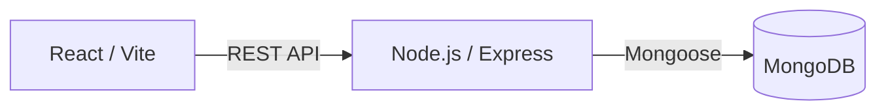

# DOMIS — Apartment Management System

**DOMIS** là ứng dụng web quản lý căn hộ và phòng cho thuê, giúp chủ nhà quản lý phòng, khách thuê, hợp đồng, dịch vụ, chỉ số điện nước và thu tiền hằng tháng trên cùng một hệ thống.

**[Trải nghiệm ứng dụng](https://apmapp2025.web.app/)** · [Mã nguồn](https://github.com/Hahaha2808/Apartment_Management_System_PE2025) · [Hướng dẫn cài đặt](#cài-đặt-và-chạy-cục-bộ)

## Mục lục

- [Giới thiệu](#giới-thiệu)
- [Chức năng chính](#chức-năng-chính)
- [Công nghệ sử dụng](#công-nghệ-sử-dụng)
- [Kiến trúc hệ thống](#kiến-trúc-hệ-thống)
- [Cấu trúc dự án](#cấu-trúc-dự-án)
- [Cài đặt và chạy cục bộ](#cài-đặt-và-chạy-cục-bộ)
- [Quy trình sử dụng](#quy-trình-sử-dụng)
- [API tổng quan](#api-tổng-quan)
- [Các lệnh phát triển](#các-lệnh-phát-triển)
- [Khắc phục sự cố](#khắc-phục-sự-cố)
- [Lưu ý khi triển khai](#lưu-ý-khi-triển-khai)

## Giới thiệu

DOMIS hỗ trợ quy trình cho thuê từ tạo phòng, lưu hồ sơ khách thuê và lập hợp đồng đến ghi chỉ số điện nước, tính tiền và theo dõi dư nợ. Đối tượng sử dụng chính là chủ nhà hoặc người trực tiếp quản lý phòng cho thuê.

Dự án được phát triển trong học phần **Programming Exercise**, thuộc **Department of Computer Science, Vietnamese-German University (VGU)**, dưới sự hướng dẫn của **Dr. To Hoai Viet**.

## Chức năng chính

| Chức năng | Mô tả |
| --- | --- |
| Tài khoản | Đăng ký tài khoản chủ nhà, đăng nhập bằng email và mật khẩu, xác thực bằng JWT. |
| Dashboard | Biểu đồ trạng thái phòng và danh sách hợp đồng sắp hết hạn. |
| Quản lý phòng | Thêm, sửa thông tin, tải ảnh, tìm kiếm, lọc và vô hiệu hóa/khôi phục phòng. |
| Khách thuê và hợp đồng | Lưu hồ sơ khách thuê, tạo hợp đồng theo phòng, quản lý tiền thuê, tiền cọc, dịch vụ và chấm dứt hợp đồng. |
| Booking Planner | Tra cứu phòng khả dụng theo khoảng ngày, loại các phòng có hợp đồng đang hoạt động giao với thời gian tìm kiếm. |
| Quản lý dịch vụ | Thiết lập đơn giá, bật/tắt dịch vụ điện, nước và các dịch vụ khác; chọn dịch vụ áp dụng cho hợp đồng. |
| Chỉ số điện nước | Ghi và cập nhật chỉ số đồng hồ, tính lượng tiêu thụ, xem lịch sử theo tháng và năm. |
| Hóa đơn và thu tiền | Lập hóa đơn theo phòng/tháng, tổng hợp các khoản phí, ghi nhận tiền đã thu và số tiền còn lại. |
| Xử lý hợp đồng hết hạn | Tác vụ nền cập nhật hợp đồng hết hạn và trạng thái phòng. |

## Công nghệ sử dụng

| Thành phần | Công nghệ |
| --- | --- |
| Frontend | React 19, Vite 6, React Router 7 |
| Giao diện và biểu đồ | SCSS, React Icons, Chart.js, react-chartjs-2 |
| Biểu mẫu | React Hook Form, Yup, React Datepicker |
| Giao tiếp API | Axios |
| Backend | Node.js, Express 5, ES Modules |
| Cơ sở dữ liệu | MongoDB, Mongoose 8 |
| Xác thực | JSON Web Token, bcryptjs |
| Tải tệp và tác vụ nền | Multer, node-cron |
| Kiểm tra mã | ESLint |
| Hạ tầng production | Firebase Hosting, Render, MongoDB Atlas |

## Kiến trúc hệ thống

Xem [tài liệu kiến trúc source](ARCHITECTURE.md) để tìm hiểu các thành phần, quan hệ dữ liệu, xác thực và luồng lưu ảnh.



Bản online sử dụng **Firebase Hosting** cho frontend, **Render** cho backend và **MongoDB Atlas** để lưu dữ liệu. Backend được triển khai tại [apartment-management-system-pe2025-1.onrender.com](https://apartment-management-system-pe2025-1.onrender.com).

> **Khi clone repository:** bạn cần tự cấu hình database riêng, bằng MongoDB local hoặc cluster Atlas của mình. Mã nguồn không kèm thông tin truy cập database production và không tự sao chép hay đồng bộ dữ liệu từ bản online.

Ảnh tải lên được lưu trong `backend/uploads/` và phục vụ qua `/uploads`; các tệp này không được lưu trong MongoDB.

## Cấu trúc dự án

```text
Apartment_Management_System_PE2025/
├── frontend/
│   ├── public/             # Tài nguyên tĩnh
│   ├── src/
│   │   ├── components/     # Biểu mẫu, biểu đồ và thành phần dùng chung
│   │   ├── pages/          # Các màn hình nghiệp vụ
│   │   ├── styling/        # Stylesheet SCSS
│   │   ├── utils/          # Tiện ích giao diện
│   │   └── main.jsx        # Khởi tạo React và khai báo route
│   ├── validations/        # Schema kiểm tra dữ liệu biểu mẫu
│   ├── vite.config.js
│   └── package.json
├── backend/
│   ├── controllers/        # Xử lý nghiệp vụ
│   ├── models/             # Schema Mongoose
│   ├── routes/             # REST API
│   ├── middleware/         # Xác thực, phân quyền và tải tệp
│   ├── db/                 # Kết nối MongoDB
│   ├── cronJobs/           # Tác vụ kiểm tra hợp đồng hết hạn
│   ├── uploads/            # Tệp ảnh tải lên
│   ├── index.js            # Điểm khởi chạy backend
│   └── package.json
└── README.md
```

## Cài đặt và chạy cục bộ

### Yêu cầu

- **Node.js:** khuyến nghị phiên bản 22 LTS hoặc 24 LTS, kèm npm.
- **MongoDB:** server cục bộ đang chạy hoặc cluster MongoDB Atlas riêng.
- **Git.**

### 1. Clone repository và cài dependency

```bash
git clone https://github.com/Hahaha2808/Apartment_Management_System_PE2025.git
cd Apartment_Management_System_PE2025

npm --prefix backend ci
npm --prefix frontend ci
```

Frontend và backend có dependency riêng. Không cần cài dependency ở thư mục gốc để thực hiện các bước khởi chạy bên dưới.

### 2. Cấu hình môi trường backend

Tạo file `backend/.env`:

```dotenv
MONGO_URL=mongodb://127.0.0.1:27017/apartment_management
SECRET_KEY=replace_with_a_long_random_secret
PORT=5000
APP_ORIGIN=http://localhost:3000
```

| Biến | Ý nghĩa |
| --- | --- |
| `MONGO_URL` | URI kết nối database của bạn, bắt buộc. |
| `SECRET_KEY` | Khóa bí mật dùng để ký và xác minh JWT. |
| `PORT` | Cổng backend, mặc định `5000`. |
| `APP_ORIGIN` | Origin frontend chính xác, không có `/` cuối; dev mặc định `http://localhost:3000`, production bắt buộc HTTPS. |
| `NODE_ENV` | Đặt `production` khi triển khai để bật cookie Secure và kiểm tra HTTPS. |

Sinh khóa ngẫu nhiên và dùng kết quả thay cho giá trị minh họa của `SECRET_KEY`:

```bash
node -e "console.log(require('node:crypto').randomBytes(48).toString('hex'))"
```

**Nếu MongoDB local bật xác thực**, bổ sung thông tin database user và `authSource` phù hợp. Ví dụ tài khoản được tạo trong database `admin`:

```dotenv
MONGO_URL=mongodb://<username>:<encoded_password>@127.0.0.1:27017/apartment_management?authSource=admin
```

**Nếu dùng MongoDB Atlas**, lấy URI tại **Connect → Drivers** của cluster và thay `MONGO_URL` bằng:

```dotenv
MONGO_URL=mongodb+srv://<db_user>:<encoded_password>@<cluster_hostname>/apartment_management?retryWrites=true&w=majority
```

Với Atlas, cần tạo database user có quyền đọc/ghi database ứng dụng và thêm IP public của máy chạy backend vào IP Access List. Dùng hostname do Atlas cung cấp; URL-encode các ký tự đặc biệt trong username/password.

Không commit `.env`, không dùng chung URI production để thử nghiệm và không đặt URI MongoDB trong frontend.

### 3. Khởi chạy backend

Mở terminal tại thư mục gốc repository:

```bash
cd backend
npm start
```

Backend mặc định chạy tại `http://localhost:5000`. Startup đợi MongoDB và index refresh session trước khi mở cổng HTTP; database user cần quyền đọc/ghi database ứng dụng và tạo index. Không dùng database production để chạy kiểm thử.

### 4. Khởi chạy frontend

Mở terminal thứ hai tại thư mục gốc repository:

```bash
cd frontend
npm run dev -- --strictPort
```

Truy cập **http://localhost:3000** để sử dụng ứng dụng.

Frontend gọi URL tương đối `/api` và `/uploads`; Vite proxy tới `http://127.0.0.1:5000`. `APP_ORIGIN` phải khớp origin trình duyệt (`http://localhost:3000` mặc định). Nếu backend chạy cổng khác, đặt `API_PROXY_TARGET` khi khởi chạy Vite; nếu đổi cổng/domain frontend, cập nhật cả `APP_ORIGIN`.

`--strictPort` ngăn Vite tự chuyển sang cổng khác khi cổng `3000` đang được sử dụng.

### 5. Khởi tạo dữ liệu

Repository chưa có script seed. Với database mới:

1. Đăng ký tài khoản tại `/register`.
2. Đăng nhập tại `/login`.
3. Tạo phòng, dịch vụ và hợp đồng để bắt đầu sử dụng.

Tài khoản và dữ liệu của bản online không tự xuất hiện trong database riêng.

## Quy trình sử dụng

1. **Tạo phòng:** nhập thông tin, giá thuê và ảnh phòng.
2. **Khai báo dịch vụ:** thiết lập đơn giá điện, nước và các khoản phí khác.
3. **Thêm khách thuê và hợp đồng:** lưu hồ sơ khách trước, chọn dịch vụ áp dụng, sau đó hoàn tất hợp đồng.
4. **Ghi chỉ số đồng hồ:** nhập chỉ số điện, nước cho kỳ tính tiền.
5. **Lập hóa đơn và thu tiền:** tạo hóa đơn theo tháng, kiểm tra các khoản phí, ghi nhận khoản thu.
6. **Theo dõi và lập kế hoạch:** xem trạng thái phòng, hợp đồng sắp hết hạn và tra cứu phòng trống qua Booking Planner.

Tiền hóa đơn gồm tiền thuê theo hợp đồng, tiền điện/nước theo lượng tiêu thụ và đơn giá, cùng các dịch vụ khác đang hoạt động được gắn với hợp đồng. Cần nhập đủ dữ liệu trước khi lập hóa đơn; phần điện/nước thiếu chỉ số hoặc đơn giá có thể được tính bằng `0`.

## API tổng quan

Qua Vite/gateway, trình duyệt dùng `/api` cùng origin frontend. Backend trực tiếp vẫn có base URL `http://localhost:5000/api`.

| Tiền tố | Chức năng |
| --- | --- |
| `/users` | Đăng ký, đăng nhập, refresh và logout |
| `/rooms` | Quản lý phòng, thống kê trạng thái và tìm phòng khả dụng |
| `/tenant` | Quản lý hồ sơ khách thuê |
| `/contracts` | Quản lý hợp đồng và tra cứu khách thuê theo hợp đồng |
| `/services` | Quản lý dịch vụ |
| `/electric-meters` | Ghi và tra cứu chỉ số điện |
| `/water-meters` | Ghi và tra cứu chỉ số nước |
| `/payments` | Lập hóa đơn và ghi nhận thu tiền |

Đăng ký qua `POST /api/users/register`. Các endpoint `POST /api/users/signin`, `/refresh`, `/logout` yêu cầu header `Origin` khớp `APP_ORIGIN` và `X-CSRF-Protection: 1`; request cookie dùng credentials. Access token được gửi cho API nghiệp vụ:

```http
Authorization: Bearer <accessToken>
```

Tài khoản mới có role `landlord`. Signin trả JSON `accessToken`/`user`, đồng thời đặt refresh token trong cookie `HttpOnly`, `SameSite=Strict`, `Path=/api/users`; production thêm `Secure`. Refresh token không được đọc/lưu bằng JavaScript hoặc đưa vào JSON.

- **Access token:** 5 phút; token cấp sát cuối phiên không vượt hạn phiên.
- **Phiên refresh:** tối đa 24 giờ từ đăng nhập, không kéo dài sau rotation. Backend chỉ lưu hash trong MongoDB; refresh thành công đổi token, sử dụng lại token cũ thu hồi phiên đó.
- **`401 TOKEN_EXPIRED`:** tự refresh và gửi lại request bị từ chối tối đa một lần; nhiều request/tab dùng chung kết quả, không làm mất biểu mẫu khi refresh thành công.
- **Token hỏng/thiếu hoặc `401 REFRESH_INVALID`:** kết thúc phiên và yêu cầu đăng nhập lại. **`403`:** thiếu quyền hoặc lỗi bảo vệ origin/CSRF, không tự refresh/đăng xuất.
- **Mạng/timeout/`5xx`:** không tự gửi lại thao tác ghi. Với lỗi refresh tạm thời, giữ form và dùng nút Thử lại; không giả định thao tác thu tiền đã thất bại nếu chưa nhận response xác định.
- **Logout:** thu hồi refresh session và xóa cookie/phiên cục bộ; access token đã cấp vẫn có hiệu lực đến `exp`. Nếu lỗi mạng khi logout, UI thông báo chưa xác nhận thu hồi server, không tự phục hồi phiên cục bộ.

JWT legacy đã cấp hạn 1 ngày giữ nguyên `exp` cũ, không tự có refresh session. Hết hạn phải signin lại. Xem [`backend/routes/`](backend/routes/) và [kiến trúc xác thực](ARCHITECTURE.md#xác-thực-và-request-nghiệp-vụ).

## Các lệnh phát triển

| Thư mục | Lệnh | Mục đích |
| --- | --- | --- |
| `backend/` | `npm start` | Khởi chạy backend |
| `frontend/` | `npm run dev -- --strictPort` | Khởi chạy môi trường phát triển |
| `frontend/` | `npm run build` | Tạo bản build tại `frontend/dist/` |
| `frontend/` | `npm run preview` | Xem thử bản build; vẫn cần backend riêng |
| `frontend/` | `npm run lint` | Kiểm tra mã bằng ESLint |
| `frontend/` | `npm test` | Regression phục hồi phiên/concurrency, dùng HTTP test server riêng, không cần MongoDB |
| `backend/` | `TEST_MONGO_URI=mongodb://127.0.0.1:27017 npm test` | Regression JWT/refresh với database local tạo riêng cho test |

Regression backend dùng Node test runner với MongoDB local **riêng**: `TEST_MONGO_URI=mongodb://127.0.0.1:27017 npm --prefix backend test`. Test tạo database tên ngẫu nhiên `domis_jwt_test_*` rồi dọn chính database đó; không trỏ vào database production. Các case middleware/token TTL không cần MongoDB có thể chạy riêng: `node --test backend/test/authMiddleware.test.js backend/test/sessionTokens.test.js`.

## Khắc phục sự cố

| Hiện tượng | Cách xử lý |
| --- | --- |
| Thiếu `MONGO_URL` | Tạo `backend/.env`, kiểm tra tên biến và chạy backend từ thư mục `backend/`. |
| Không kết nối được MongoDB | Kiểm tra URI, server/cluster, database user và IP Access List nếu dùng Atlas. |
| `Command find requires authentication` | Bổ sung username/password và `authSource` phù hợp vào URI; kiểm tra quyền database user rồi khởi động lại backend. |
| Frontend không gọi được API hoặc lỗi CORS | Kiểm tra Vite/gateway proxy `/api`, backend và `APP_ORIGIN` đúng origin trình duyệt; signin/refresh/logout cần header chống CSRF. |
| Cổng `3000` hoặc `5000` đang bận | Chọn cổng khác; cập nhật `APP_ORIGIN` cho frontend hoặc `API_PROXY_TARGET` cho backend tương ứng. |
| API trả `401` | `TOKEN_EXPIRED` được client tự refresh; `TOKEN_INVALID`/`AUTH_REQUIRED` hoặc refresh bị từ chối yêu cầu signin lại. |
| API trả `403` | Kiểm tra quyền vai trò/ownership; với signin/refresh/logout, kiểm tra Origin và `X-CSRF-Protection`, không tự xóa phiên. |
| Không tìm thấy stylesheet trên Linux | Kiểm tra chữ hoa/thường của đường dẫn import khớp chính xác với tên file. |
| Dashboard chưa có dữ liệu | Tạo phòng và hợp đồng trong database đang kết nối. |

## Lưu ý khi triển khai

- Production phải có một public HTTPS origin phục vụ frontend, `/api` và `/uploads`; xem cấu hình Nginx phía dưới. Không gọi cookie refresh trực tiếp giữa Firebase `web.app` và Render `onrender.com`: third-party cookie có thể bị trình duyệt chặn.
- Cấu hình backend `MONGO_URL`, `SECRET_KEY`, `NODE_ENV=production`, `APP_ORIGIN=https://<public-host>`; không đưa credential thật vào repo/bundle/log. Database phải tạo được index của refresh session.
- Trình duyệt cần secure context và Web Locks để phối hợp rotation giữa các tab; không dùng khóa localStorage không nguyên tử làm fallback.
- Lưu bền vững và sao lưu `backend/uploads/` cùng database; việc chuyển database lên Atlas không tự chuyển các tệp ảnh.
- Tác vụ hết hạn hợp đồng chạy lúc **00:05 mỗi ngày**, theo múi giờ tiến trình Node.js; backend cần hoạt động tại thời điểm đó.
- Không sử dụng database production để phát triển hoặc kiểm thử thay đổi.

### Gateway HTTPS cùng origin

[`deploy/nginx.conf.template`](deploy/nginx.conf.template) dùng với image Nginx chính thức, phục vụ `frontend/dist`, proxy API/ảnh tới backend, giữ Origin/Set-Cookie và không tự retry upstream. Triển khai trên host có DNS/TLS hợp lệ:

```bash
npm --prefix frontend run build
docker run --detach --name domis-gateway --restart unless-stopped \
  --publish 80:80 --publish 443:443 \
  --env PUBLIC_HOST=domis.example.com \
  --env BACKEND_ORIGIN=http://backend:5000 \
  --network domis \
  --mount type=bind,src=\"$PWD/frontend/dist\",dst=/usr/share/nginx/html,readonly \
  --mount type=bind,src=\"$PWD/deploy/nginx.conf.template\",dst=/etc/nginx/templates/default.conf.template,readonly \
  --mount type=bind,src=/absolute/path/to/tls,dst=/etc/nginx/tls,readonly \
  nginx:1.28-alpine
```

Thay domain/upstream bằng cấu hình thật; network `domis` phải tồn tại và có backend tên `backend` đang chạy, hoặc dùng upstream nội bộ truy cập được từ gateway. Thư mục TLS cần `fullchain.pem` và `privkey.pem` được cấp/gia hạn riêng; backend đặt `APP_ORIGIN` bằng origin HTTPS public chính xác. Không đưa khóa TLS vào source.

Phát hành hoặc rollback backend/frontend/gateway đồng bộ. Khi rollback tính năng refresh, thu hồi các refresh session của đợt phát hành và xóa cookie đúng Path; không xóa dữ liệu phòng/hợp đồng/hóa đơn. Trước phát hành, chạy smoke HTTPS trong trình duyệt để xác nhận cookie Secure/HttpOnly, refresh nhiều tab, CSRF và logout; build/test đơn lẻ không chứng minh cấu hình production.

