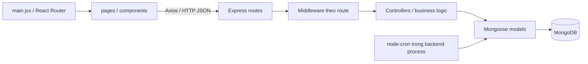
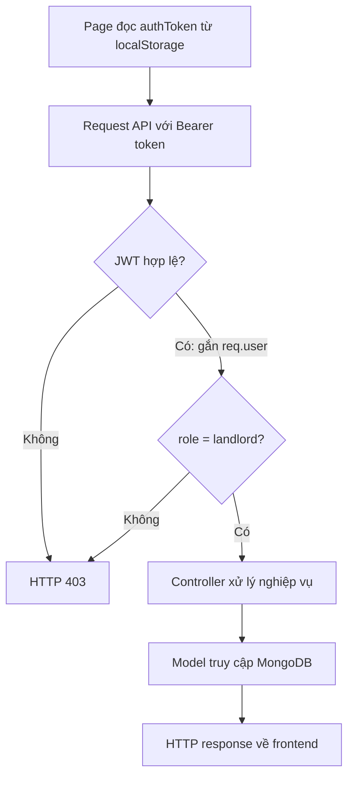
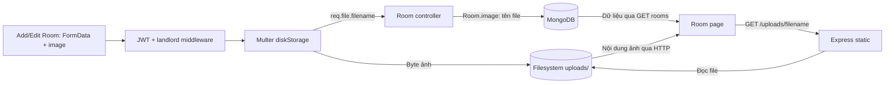

# Design

## Context

Xem [proposal.md](proposal.md) cho mục đích thay đổi. Source hiện có hai ứng dụng JavaScript độc lập: React/Vite và Express/Mongoose; chưa có `ARCHITECTURE.md`. README đã chứa hướng dẫn cài đặt và thông tin triển khai do chủ dự án xác nhận.

Design cần thiết để chốt ranh giới giữa kiến trúc đọc từ source và topology production, cũng như tránh mô tả file upload thành dữ liệu MongoDB hoặc chức năng đồng bộ GitHub. Đây vẫn là thay đổi tài liệu thuần túy, không cần delta specs.

### Căn cứ từ source

| Khu vực | Căn cứ | Nội dung quan sát được |
| --- | --- | --- |
| Frontend entrypoint | [main.jsx](../../../frontend/src/main.jsx) | `createBrowserRouter`, các page/component và `RouterProvider`; không có lớp backend-for-frontend. |
| API client | [SignIn.jsx](../../../frontend/src/components/SignIn.jsx), [Room.jsx](../../../frontend/src/pages/Room.jsx) | Axios được gọi trực tiếp từ component/page; token lưu ở `localStorage.authToken`; URL API/ảnh là localhost. |
| Backend composition | [index.js](../../../backend/index.js) | CORS, JSON body, tám nhóm API, static `/uploads`, server listen và khởi động cron. |
| Xác thực | [userController.js](../../../backend/controllers/userController.js), [authMiddleware.js](../../../backend/middleware/authMiddleware.js) | bcryptjs, JWT thời hạn một ngày, `SECRET_KEY`, xác minh Bearer token và kiểm tra vai trò `landlord`. |
| Tải ảnh | [roomRoutes.js](../../../backend/routes/roomRoutes.js), [upload.js](../../../backend/middleware/upload.js), [roomController.js](../../../backend/controllers/roomController.js) | JWT/role trước Multer; file ghi xuống `uploads/`; controller chỉ lưu `req.file.filename` trong trường `image`. |
| Kết nối database | [db.js](../../../backend/db/db.js) | Mongoose kết nối bằng `MONGO_URL`; lỗi cấu hình/kết nối dẫn tới thoát process. |
| Quan hệ dữ liệu | [Contract.model.js](../../../backend/models/Contract.model.js), [Room.model.js](../../../backend/models/Room.model.js), [Service.model.js](../../../backend/models/Service.model.js), [Payment.model.js](../../../backend/models/Payment.model.js) | Tham chiếu `ObjectId`, contract nối room/tenant/services; hóa đơn lưu chi tiết phí và trạng thái thanh toán. |
| Nghiệp vụ hóa đơn | [paymentController.js](../../../backend/controllers/paymentController.js) | Tính tiền từ hợp đồng, dịch vụ đang active và đồng hồ; không có cổng thanh toán bên ngoài. |
| Tác vụ nền | [contractExpirationJob.js](../../../backend/cronJobs/contractExpirationJob.js) | `5 0 * * *`; tìm hợp đồng active quá hạn, đổi expired rồi đặt phòng available. |

## Goals / Non-Goals

**Goals:**

- Người đọc đi được từ màn hình đến route, middleware, controller, model và nơi lưu dữ liệu bằng các liên kết source.
- Flowchart thể hiện đúng thứ tự xử lý, ranh giới process và hai nơi lưu trữ độc lập: MongoDB và filesystem.
- Phân biệt ba loại thông tin: hành vi quan sát từ checkout, topology do chủ dự án xác nhận, cấu hình hạ tầng chưa xác minh.
- Nội dung tiếng Việt, identifier và đường dẫn giữ nguyên; đọc được trực tiếp trên GitHub.

**Non-Goals:**

- Không thêm service/repository layer, API client tập trung hoặc một kiến trúc mới không có trong source.
- Không chuyển ảnh lên Cloudinary, Firebase Storage, S3 hoặc MongoDB GridFS; không cấu hình persistent disk.
- Không sửa lỗi auth, phân quyền, cron, upload, UI hay đường dẫn API; không thêm test hoặc dependency ứng dụng.
- Không truy cập `.env` thật, dữ liệu khách thuê, tài khoản demo hoặc thực hiện request ghi lên production.

## Decisions

### 1. Một tài liệu root, README chỉ dẫn đường

Chọn `ARCHITECTURE.md` thay vì khởi tạo một bộ `docs/` mới: repository hiện có một README public và chưa có quy ước thư mục tài liệu. README giữ hướng dẫn chạy; thêm một liên kết ở mục kiến trúc, không viết lại toàn README hay sao chép các bước cài đặt.

Dàn ý tài liệu:

1. Phạm vi và cách đọc: kiến trúc hiện tại, không phải thiết kế tương lai.
2. Tổng quan thành phần và trách nhiệm thư mục.
3. Frontend: entrypoint, routing, page/component, Axios, token.
4. Backend: bootstrap, tám nhóm API, middleware, controller và model.
5. Vòng đời xác thực và request nghiệp vụ.
6. Upload và phục vụ ảnh.
7. Mô hình dữ liệu: User/Room/Service, Tenant/Contract, Meter và Payment.
8. Tác vụ cron và vòng đời hợp đồng/phòng.
9. Local so với online, cấu hình và giới hạn lưu trữ.
10. Tham chiếu source.

### 2. Ba flowchart, mỗi sơ đồ trả lời một câu hỏi

Chọn Mermaid `flowchart` thay cho ảnh nhúng hoặc sequence diagram: GitHub hỗ trợ trực tiếp và người đọc có thể sửa cùng Markdown. Các sơ đồ dưới đây là nội dung định hướng để đưa vào tài liệu khi apply.

#### Thành phần source: request đi qua những lớp nào?

Đây là sơ đồ phụ thuộc/xử lý tổng quan, không khẳng định mọi route đều dùng cùng middleware. Controllers gọi model trực tiếp; không vẽ thêm tầng service hoặc repository. Liệt kê các prefix `/api/users`, `/api/rooms`, `/api/tenant`, `/api/contracts`, `/api/services`, `/api/electric-meters`, `/api/water-meters`, `/api/payments` ở bảng module, không lặp trong sơ đồ.

#### Request bảo vệ: JWT và vai trò được kiểm tra ở đâu?

Phần văn bản trước sơ đồ nêu đăng ký/đăng nhập là public, mật khẩu được hash bằng bcryptjs, đăng nhập trả JWT một ngày; frontend lưu token rồi mới dùng cho các request sau. Cổng role là ranh giới quyền truy cập route, không phải bằng chứng mọi controller đã cô lập dữ liệu đa chủ nhà đúng. Static `/uploads` không đi qua cổng JWT trong source hiện tại.

#### Ảnh: byte ảnh và dữ liệu phòng đi đâu?

Tệp upload nằm trên host chạy backend, không tự xuất hiện trên máy người phát triển hoặc GitHub. MongoDB lưu tên file, không lưu byte ảnh trong mô hình này. Không trình bày các bước như một transaction giữa filesystem và MongoDB; chúng không có cơ chế commit nguyên tử chung trong code.

### 3. Quan hệ dữ liệu và cron dùng prose/bảng có liên kết

Không thêm một sơ đồ ER hoặc cron trùng ý với flowchart tổng quan. Bảng dữ liệu thể hiện rõ:

- `Room.landlordID` và `Service.landlordID` tham chiếu `User`.
- `Contract.roomId`, `tenantId`, `serviceIds` nối phòng, người thuê và dịch vụ; trạng thái `active`, `terminated`, `expired`.
- `ElectricMeter.contract_id` / `WaterMeter.contract_id` tham chiếu hợp đồng; lượng tiêu thụ là chênh lệch chỉ số.
- `Payment.contract_id`, `room_id`, các khoản phí nhúng và trạng thái `unpaid`, `partial`, `paid`.

Cron chạy trong chính backend process lúc 00:05 theo múi giờ tiến trình; không phải worker độc lập, không quét ngay khi startup, không khẳng định có chạy bù. Mô tả đúng thao tác hiện có: hợp đồng active quá hạn thành expired, phòng liên quan thành available; không nâng thành bảo đảm chống trùng hợp đồng.

### 4. Tách source local khỏi topology production

Bảng môi trường ghi frontend local cổng 3000, backend local cổng 5000, MongoDB theo `MONGO_URL`; online là Firebase Hosting, Render và Atlas theo thông tin chủ dự án. Không suy ra commit đang deploy giống checkout hoặc production có cấu hình disk nào.

Nêu đúng ba biến `MONGO_URL`, `SECRET_KEY`, `PORT`; URL API và ảnh ở frontend hiện viết trực tiếp, CORS local cố định. Không dựng lên cấu hình `VITE_API_BASE_URL` chưa có ở các callsite. Clone dùng database riêng, không có đồng bộ production tự động.

Ảnh là trạng thái filesystem độc lập với Atlas. Với filesystem tạm của Render, ảnh mới có nguy cơ mất sau restart/redeploy nếu đường dẫn upload không nằm trên persistent disk; cấu hình thực tế của service chưa biết. Chỉ ghi rủi ro và dẫn [tài liệu Render](https://render.com/docs/disks), không biến đề xuất lưu trữ cloud thành kiến trúc đã triển khai.

### 5. Xác minh tài liệu, không tạo thay đổi runtime

Khi apply, kiểm tra đường dẫn/anchor, hàng bảng, code fence và render thực tế cả ba Mermaid flowchart bằng renderer có sẵn hoặc công cụ tạm ngoài dependency ứng dụng. Đọc lại node/edge so với source, đặc biệt 403, vị trí ghi ảnh, static route và cron. Không thêm permanent test kiểm tra text Markdown; không chạy nghiệp vụ ghi dữ liệu để chứng minh một thay đổi tài liệu.

## Risks / Trade-offs

- [Source thay đổi sau khi lập plan] → Đối chiếu lại đúng các file tham chiếu trước khi xuất bản; không ghi đè chỉnh sửa README của người dùng.
- [Nhầm production với local] → Tách bảng môi trường, gắn nguồn xác nhận và đánh dấu cấu hình persistent disk là chưa xác minh.
- [Sơ đồ tạo cảm giác bảo mật/transaction đầy đủ] → Giới hạn sơ đồ theo route đại diện và chỉ rõ phần auth route không thay thế kiểm tra ownership; filesystem và DB độc lập.
- [Tài liệu phình thành báo cáo đồ án] → Chỉ ghi cấu trúc source, các luồng và ràng buộc vận hành; không trích chương báo cáo, điểm đóng góp hay nhật ký tool.
- [Renderer Mermaid không tương thích] → Dùng flowchart chuẩn, node label có dấu ngoặc kép, không script/click handler; preview trước khi kết thúc apply.

## Migration Plan

Không có migration dữ liệu hoặc deployment. Khi apply, tạo `ARCHITECTURE.md`, thêm liên kết tương đối trong README rồi xác minh hiển thị/liên kết. Hoàn tác chỉ phần tài liệu được thay đổi nếu cần, không thay đổi cấu hình database hoặc các file runtime.
